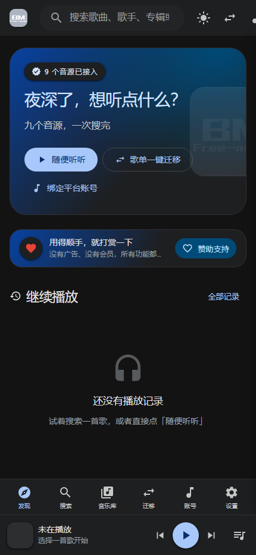

# BM Free Music

> 多平台聚合网络音乐播放器 · Material 3 设计 · 亮暗双主题 · 安卓应用

一次搜索同时打九个来源的曲库，主音源放不了的会员曲目自动降级到第三方聚合站拿完整音频。装好即用，不需要电脑配合。



---

## 安装

`Releases/BMFreeMusic-1.3.0.apk` — 0.62 MB，包名 `com.bmfreemusic.app`，Android 6.0+（minSdk 23 / targetSdk 34）。

传到手机点击安装，允许「安装未知来源应用」。

APK 内置一个用 Java 写的迷你 HTTP 服务器（`android/java/.../LocalServer.java`），承担静态托管、`/api/raw` 反代、音频流 Range 转发、图片代理、聚合站适配、本地已下载文件回流。前端是一套纯静态文件，直接打进 assets。

---

## 九个音源

| 音源 | 搜索 | 歌单 | 播放 | 歌词 |
|---|---|---|---|---|
| 网易云音乐 | ✔ | ✔ | ✔ 免费曲 | ✔ |
| QQ 音乐 | ✔ | ✔ | ✔ 免费曲 | ✔ |
| 酷狗音乐 | ✔ | ✔ | ✔ 免费曲 | ✔ |
| 酷我音乐 | ✔ | ✔ | ✔ | ✔ |
| 咪咕音乐 | ✔ | ✔ | 走兜底 | — |
| 哔哩哔哩 | ✔ | — | ✔ dash | — |
| 歌曲宝 | ✔ | — | ✔ | — |
| 下歌宝 | ✔ | — | ✔ | — |
| 歌曲海 | ✔ | — | ✔ | — |

最后三个是聚合站，把各平台音频转存过一遍，会员曲往往能拿到完整直链。

### 播放失败怎么降级

```
主音源解析失败
   ↓
① 聚合站：歌曲宝 → 下歌宝 → 歌曲海
   歌名×0.65 + 歌手×0.35 算相似度，≥0.62 才采用，命中 0.88 提前收手
   ↓
② 常规源：网易云 / QQ / 酷狗 / 酷我 / B站
   同源最多 2 个候选，总共 6 个
   ↓
③ 全挂才报错
```

每一级拿到的 URL 都会先 `Range: bytes=0-1` 探一下，确认返回的是 `audio/*` 才交出去——不会给你放一个 HTML 错误页。

---

## 功能

**搜索** 渐进式：网易云和 QQ 先回先显示，其余六源结果到了自动合并去重，不用等最慢的那个。

**歌词两态** 默认三行窗口（上一行 / 当前行 / 下一行，当前行居中放大），点一下收起封面铺满全部歌词并跟随滚动。

**歌单迁移** 粘贴链接就行，整段分享文案、带中文的链接、`#/playlist?id=` 这种 hash 路由都能认。后台任务执行，切页面不中断。

**账号绑定** APK 里点「网页登录」直接打开平台官网，登录成功后自动抓取 Cookie。

**歌手简介** 曲目菜单和播放页的歌手名都能点，数据来自百度百科，带本名、外文名、国籍、出生日期等结构化字段。

**下载** 曲目菜单「下载到本地」，走系统 DownloadManager 存到 `Music/`。

**下载过的歌优先本地** 播过的曲目会记进下载索引，下次播放直接读本地文件，不联网；文件被删了自动回落到在线音源。

**偏好设置** 在设置里勾选偏好音源和偏好曲风。搜索和换源时偏好平台排前面，优先级略高于同分匹配；「随便听听」会按偏好曲风抓歌。

**检查更新** 启动时经公共加速代理拉 `latest.json` 比对版本，有新版本弹窗，确认后直接下载并拉起安装器。12 小时内只查一次。

**通知栏控制** 封面、歌名、歌手，三个按钮切换。锁屏和耳机线控一并接管。

**歌单体检** 逐首探测真实可用性，播不了的标红并支持一键移除。

**自动播放兜底** 被系统拦截后记住状态，点页面任何地方都会自动续上。

**数据** 双通道持久化，重启不丢。

---

## 目录结构

```
BMFreeMusic/
├── index.html                 应用外壳
├── start.bat                  Windows 一键启动
├── manifest.webmanifest       PWA 清单
├── sw.js                      Service Worker（只缓存外壳）
├── server/
│   ├── index.js               静态服务 + 反代 + 流代理
│   └── aggregator.js          歌曲宝 / 下歌宝 / 歌曲海 适配
├── scripts/
│   ├── check-sources.mjs      音源自检
│   ├── push-to-github.sh      推送到 GitHub
│   └── push-to-github.bat
├── android/                   安卓工程（不用 Gradle）
│   ├── build-apk.sh           一条命令出 APK
│   ├── AndroidManifest.xml
│   ├── java/com/bmfreemusic/app/
│   │   ├── MainActivity.java   WebView 外壳 + 原生桥
│   │   ├── LocalServer.java    内置 HTTP 服务器
│   │   ├── PlaybackService.java 通知栏媒体控制
│   │   ├── Proxy.java          上游转发 + SSRF 防护
│   │   ├── Aggregator.java     聚合站 Java 实现
│   │   └── Json.java           极简 JSON
│   └── res/
├── Releases/                  发行包
├── assets/                    图标、赞助收款码
└── src/
    ├── css/
    │   ├── tokens.css         设计令牌（亮/暗两套）
    │   ├── base.css           Reset 与排版
    │   ├── layout.css         应用骨架
    │   ├── components.css     组件
    │   └── views.css          页面专属
    └── js/
        ├── app.js             入口：路由、播放条、快捷键
        ├── core/
        │   ├── store.js       状态 + 双通道持久化
        │   ├── player.js      播放内核
        │   ├── theme.js       主题
        │   ├── jobs.js        后台任务
        │   ├── playfail.js    失败标记
        │   └── util.js
        ├── api/
        │   ├── gateway.js     走本地代理
        │   ├── sources.js     九个音源的适配
        │   └── wiki.js        歌手简介
        ├── ui/
        │   ├── icons.js       Material Symbols
        │   ├── components.js  曲目行 / 磁贴 / 对话框
        │   ├── artistbio.js   简介弹窗
        │   └── toast.js
        └── views/             八个页面 + 全屏播放
```

---

## 重新构建 APK

```bash
bash android/build-apk.sh
```

走 `aapt2 → javac → d8 → 打包 → zipalign → apksigner` 全手工链路，不需要 Gradle，也不需要 Android Studio。

| 组件 | 位置 |
|---|---|
| JDK 17 | `.buildenv/jdk-17.0.21+9`（305 MB，可删，重建时重新下载） |
| build-tools 34 | `%LOCALAPPDATA%\Android\Sdk\build-tools\34.0.0` |
| platforms/android-34 | `%LOCALAPPDATA%\Android\Sdk\platforms\android-34` |
| Python | 只用来往 APK 里注入 `classes.dex` |

签名密钥 `android/bmfm.keystore`（密码 `bmfm123456`，别名 `bmfm`），首次构建自动生成。覆盖安装必须用同一个密钥，**别删**。

---

## 移动端适配

手机上不是把桌面布局缩小，而是重新排了一遍。

| 问题 | 处理 |
|---|---|
| 5 列网格把标题压成一两个字 | ≤760px 改 3 列，专辑列隐藏、专辑名并进歌手行 |
| 封面被挤成竖条 | 固定 `40~44px` + `flex-basis` 锁死 |
| 播放条元素重叠 | 收起随机/循环/音量/全屏，只留上一首、播放、下一首、队列 |
| 全屏播放页被内容撑开滚动 | `overflow:hidden` + grid 三段分配，封面按 `min(78vw, 36vh, 380px)` 缩放 |
| 音源按钮折行挤成一团 | 改横向滚动 |
| 界面能捏合缩放 | 见下 |

### 尺寸锁定

```java
s.setSupportZoom(false);
s.setBuiltInZoomControls(false);
s.setDisplayZoomControls(false);
s.setTextZoom(100);                   // 忽略系统字体大小
s.setUseWideViewPort(false);          // 1 CSS px = 1 dp
s.setLoadWithOverviewMode(false);     // 关键：否则 WebView 会把整页缩小
```

页面侧再补：`touch-action: manipulation`、`text-size-adjust: 100%`、`overscroll-behavior: none`，`viewport` 带 `user-scalable=no`。

`setLoadWithOverviewMode(true)` 是最大的坑——它会让 WebView 为了「一屏显示全页」整体缩小，表现就是所有元素都小一圈、留白特别多。

---

## 快捷键

| 键 | 作用 |
|---|---|
| `空格` | 播放 / 暂停 |
| `←` `→` | 快退 / 快进 5 秒 |
| `↑` `↓` | 音量 ±5% |
| `M` | 静音 |
| `S` | 随机 |
| `R` | 循环 |
| `Q` | 播放队列 |
| `F` | 全屏播放 |
| `Ctrl/⌘ + K` | 聚焦搜索 |
| `Esc` | 关闭浮层 |

安卓物理返回键：优先收浮层 → 关播放页 → 回上一页 → 双击退出。

---

## 音源自检

```bash
node scripts/check-sources.mjs           # 默认关键词「周杰伦」
node scripts/check-sources.mjs 五月天
```

逐个源输出搜索 / 歌单 / 播放地址 / 歌词状态。上游接口随时会变，这份体检就是为此准备的。

聚合站单独验：

```bash
curl "http://127.0.0.1:5173/api/aggr/search?site=gequbao&kw=周杰伦&limit=3"
curl "http://127.0.0.1:5173/api/aggr/play?site=gequbao&id=4190"
```

---

## 账号绑定

**APK**：「平台账号」页每个平台都有 **网页登录** 按钮，点开平台官网，登录成功的一瞬间抓 Cookie，弹窗自动关闭。判据是「关键 Cookie 是否出现」，用密码、短信还是扫码都行。

| 平台 | 判据 |
|---|---|
| 网易云 | `MUSIC_U` |
| QQ 音乐 | `qm_keyst` |
| 酷狗 | `KuGoo` |
| 酷我 | `kw_token` |
| 咪咕 | `uid` / `token` |
| 哔哩哔哩 | `SESSDATA` |

**手动粘贴**：登录网页版平台 → F12 → Application → Cookies，拼成 `key=value; key2=value2` 粘进「粘贴 Cookie」。

两种方式最终都只写进本机，经本地代理转发，不上传任何第三方。

---

## 歌单一键迁移

支持粘贴：

- `https://music.163.com/#/playlist?id=3778678`（hash 路由）
- `https://y.qq.com/n/ryqq/playlist/7382651`
- `https://www.kugou.com/yy/special/single/xxxxx.html`
- `https://www.kuwo.cn/playlist_detail/xxxxx`
- `https://www.bilibili.com/audio/am12345`
- `netease:3778678`、`qq:7382651`
- 光秃秃的歌单 ID
- 整段分享文案：`分享周杰伦的单曲《稻香》: https://music.163.com/song?id=185809 (来自@网易云音乐)`

最后这条靠 `extractUrl()`：先正则抠出 `http(s)` 链接，再逐字符剪掉末尾粘上来的中文标点，直到能被 `URL` 解析。

两种模式：**智能换源**（每首重新匹配）和 **原样保留**。迁移在后台跑，有逐行日志和统计。

---

## 数据持久化

| 通道 | 位置 | 作用 |
|---|---|---|
| localStorage | WebView 数据目录 | 页面侧主存储 |
| SharedPreferences | APK 私有目录 `bmfm_store` | APK 专用，origin 变了也能恢复 |
| 导出文件 | 用户自选 | 换设备用 |

**端口必须固定**：WebView 的 localStorage 按 `http://127.0.0.1:端口` 隔离，随机端口等于每次都换一个新站点，之前存的全读不到。所以本地服务器固定监听 `18321`，被占用才递增，递增后靠 SharedPreferences 兜底恢复。

启动时两份数据比 `_savedAt` 时间戳，谁新用谁。

设置页可以导出完整备份为 JSON。

---

## 赞助

首页 hero 下方有一条入口，点「赞助支持」进独立页面 `#/sponsor`。入口 10 秒后自动收起，点过就不再自动隐藏。

**无论你是否赞助，本播放器永远免费使用，开源万岁。**

---

## 已知限制

- 上游接口都是非公开的，随时可能变更；`check-sources.mjs` 就是为这种情况准备的。
- **维基百科在部分网络下不可达**，这时简介会显示百度百科的内容，来源标注在卡片底部。
- 咪咕只做搜索补全，音频地址需额外鉴权，播放自动降级。
- 聚合站依赖 HTML 解析，页面结构改动会导致失效——改 `server/aggregator.js` 里的正则即可。
- 酷我部分曲目拿不到封面，显示占位图。
- B 站搜索偶尔返回 `-412 banned`，属于上游风控。
- 音乐版权归各平台所有，本项目只做聚合与播放，不存储任何音频文件。
